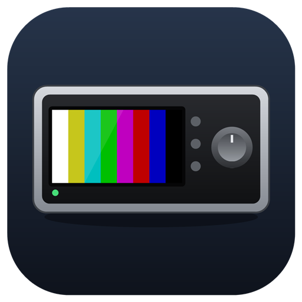

<p align="center"></p>

<h1 align="center">UBMDF — Universal Blackmagic Devices Flasher</h1>

<p align="center">Cross-platform CLI + GUI for flashing Blackmagic devices over their USB service port.<br>
Windows · Linux · macOS · Android — currently the UltraStudio 4K Mini (Desktop Video 11.5 – 16.5).</p>

> [!CAUTION]
> **Flashing firmware can permanently brick your device. You flash at your own risk.**
> UBMDF is unofficial and comes with **no warranty**. Read the [disclaimer and flashing checklist](DISCLAIMER.md) first.

The flash sequence matches a USB trace of Blackmagic's official `DesktopVideoUpdateTool` 16.5 op for op (32/32). Every image is byte-identical to the one in Blackmagic's installer.

## Screenshots

| Firmware | Devices |
|---|---|
|  |  |
| **Update** | **Log** |
|  |  |

## Features

- Live detection of service-port devices, with identity and state readout and a JSON dump
- 43 flashable Desktop Video versions built in, each sha256-checked, with a step-by-step flash log
- Firmware index plus Blackmagic catalog check, download and inventory
- `replay-check`: compares UBMDF's flash with a USB capture of the official updater
- `probe`: a logged, read-only command sweep of the service port

## Download

Ready-to-use builds are on the [Releases](https://github.com/harrypm/UBMDF/releases) page:

| Platform | File |
|---|---|
| Windows | `ubmdf-windows-x64.exe` |
| Linux | `UBMDF-x86_64.AppImage` |
| macOS (Apple Silicon + Intel) | `UBMDF-macos-universal.zip` → `UBMDF.app` |
| Android (arm64, USB OTG) | `UBMDF-android-arm64.apk` (sideload) |

Every push is also built by [GitHub Actions](https://github.com/harrypm/UBMDF/actions).

> [!IMPORTANT]
> The service port needs one-time setup before UBMDF can open it:
> - **Windows:** bind the service port to **WinUSB** with Zadig.
> - **Linux:** add the **udev rule**.
>
> See [platforms](docs/platforms.md) for both.

> [!NOTE]
> - **macOS:** the app is ad-hoc signed, not notarized. The first time, right-click it and choose **Open**.
> - **Android:** the APK is debug-key signed, for sideloading. The phone must support USB host (OTG); see [Android](docs/platforms.md#android).

## Quick start

```
ubmdf                                    # GUI (no arguments)
ubmdf list                               # find service-port devices
ubmdf info                               # identity and state (read-only)
ubmdf index list                         # flashable bundles
ubmdf flash "<firmware>/ultrastudio4kmini/dv-16.5/manifest.json"
```

> [!TIP]
> `<firmware>` is the firmware folder. On macOS that's `~/Library/Application Support/UBMDF/firmware`; see [where UBMDF keeps its data](docs/firmware-data.md#where-ubmdf-keeps-its-data) for the others.

> [!WARNING]
> - **Keep the device powered and connected.** Never unplug or power off the device while a flash runs.
> - **After the flash, power-cycle.** Unplug the USB cable, then power-cycle the unit.
> - **"Finished" is not "verified".** The service port has no read-back, so a finished flash means every transfer was accepted, **not** that the contents were verified.
> - **Avoid DV 12.9.** Desktop Video **12.9** is flagged known-bad: it bricked units through Blackmagic's own updater.
> - **The `dv-11.4.1` bundle is untested.** It has never been flashed on hardware.

## Documentation

| | |
|---|---|
| [CLI reference](docs/cli.md) | all commands, flash log, `replay-check`, `probe`, paths |
| [GUI](docs/gui.md) | tabs, readouts, options, icon, screenshots |
| [Protocol](docs/protocol.md) | service-port commands, official updater trace, probe results |
| [Firmware data](docs/firmware-data.md) | index, data locations, Git LFS, harvest, installer formats |
| [Firmware map](docs/firmware-map.md) | which image is in which Desktop Video version |
| [Tracing](docs/tracing.md) | tracing Blackmagic's updater on macOS (`tools/usbtrace`) |
| [Building](docs/building.md) | build options, bundled firmware, CI, cross-compiling |
| [Platforms](docs/platforms.md) | Windows driver, Linux udev, macOS |
| [Disclaimer](DISCLAIMER.md) | warranty, affiliation, risks, pre-flash checklist |

## License and disclaimer

- **Tool code:** MIT, provided "AS IS" without warranty of any kind.
- **Affiliation:** UBMDF is not affiliated with, endorsed by or supported by Blackmagic Design. Blackmagic Design product names are trademarks of their owner.
- **Firmware:** the images are Blackmagic Design property. Archive and flash only images obtained through official installers, for devices you own.
