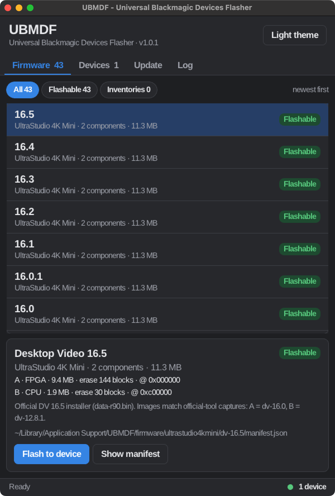
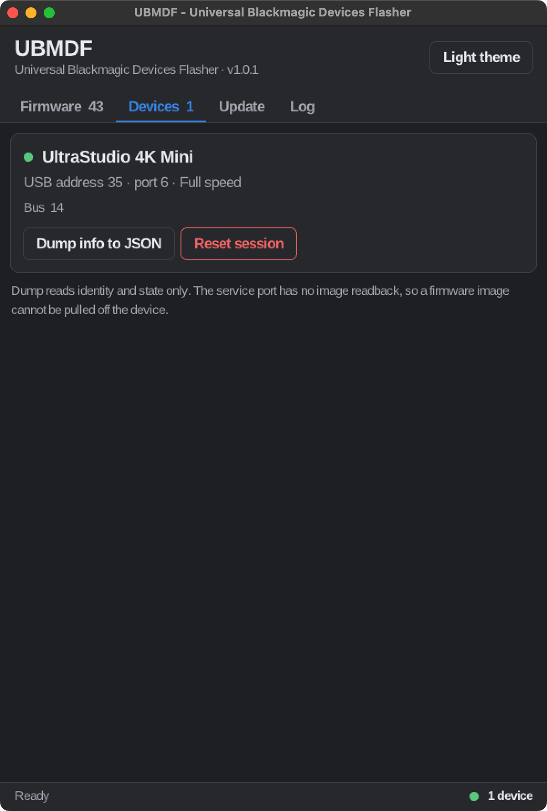
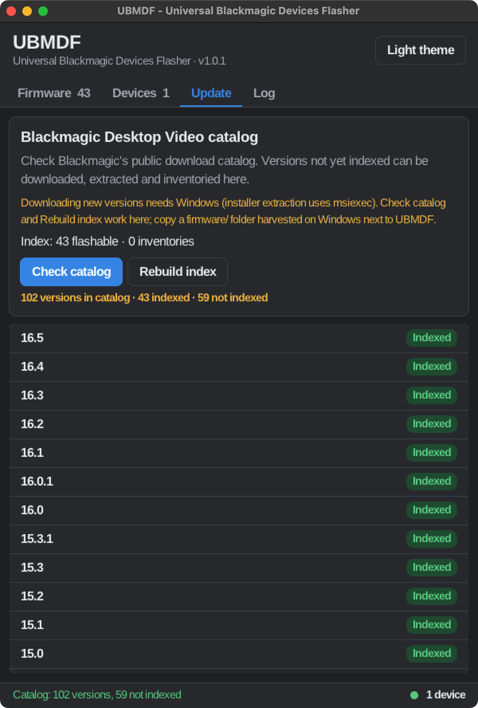
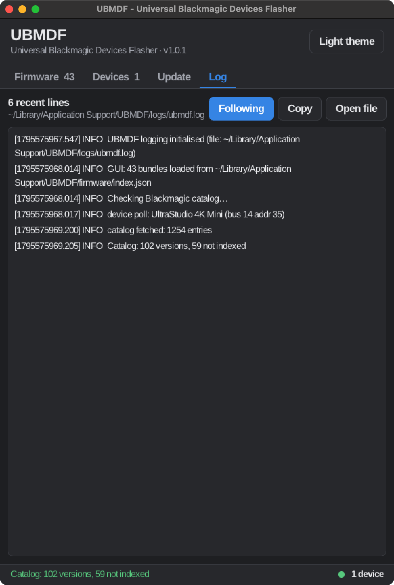

<p align="center"></p>

<h1 align="center">UBMDF — Universal Blackmagic Devices Flasher</h1>

<p align="center">Cross-platform CLI + GUI for flashing Blackmagic devices over their USB service port.<br>
Windows · Linux · macOS — currently the UltraStudio 4K Mini (Desktop Video 11.5 – 16.5).</p>

The flash sequence matches a USB trace of Blackmagic's official `DesktopVideoUpdateTool` 16.5 op for op (32/32), and every image is byte-identical to the official one.

## Screenshots

| Firmware | Devices |
|---|---|
|  |  |
| **Update** | **Log** |
|  |  |

## Features

- Live detection of service-port devices, with identity and state readout and a JSON dump
- 43 flashable Desktop Video versions built in, each sha256-checked, with a step-by-step flash log
- Firmware index plus Blackmagic catalog check, download and inventory
- `replay-check`: compare UBMDF's flash with a USB capture of the official updater
- `probe`: logged, read-only command sweep of the service port

## Download

[Releases](https://github.com/harrypm/UBMDF/releases) for ready to use binary's. 

Builds for Windows (`.exe`), Linux (`.AppImage`) and macOS (universal `.app`) come from [GitHub Actions](https://github.com/harrypm/UBMDF/actions).

The macOS app is ad-hoc signed, so right-click → Open the first time.

- **Windows:** bind the service port to WinUSB with Zadig.
- **Linux:** add the udev rule.
- See [platforms](docs/platforms.md) for both.

## Quick start
```
ubmdf                                    # GUI (no arguments)
ubmdf list                               # find service-port devices
ubmdf info                               # identity and state (read-only)
ubmdf index list                         # flashable bundles
ubmdf flash "<firmware>/ultrastudio4kmini/dv-16.5/manifest.json"
```
`<firmware>` is the firmware folder; on macOS that's `~/Library/Application Support/UBMDF/firmware` ([locations](docs/firmware-data.md#where-ubmdf-keeps-its-data)). After a flash, unplug the USB cable, then power-cycle the unit. The device has no read-back, so a flash means every transfer was accepted, **not** that the contents were verified.

## Documentation
| | |
|---|---|
| [CLI reference](docs/cli.md) | all commands, flash log, `replay-check`, `probe`, paths |
| [GUI](docs/gui.md) | tabs, readouts, options, icon, screenshots |
| [Protocol](docs/protocol.md) | service-port commands, official updater trace, probe results |
| [Firmware data](docs/firmware-data.md) | index, data locations, Git LFS, harvest, installer formats |
| [Firmware map](docs/firmware-map.md) | which image is in which Desktop Video version |
| [Tracing](docs/tracing.md) | tracing Blackmagic's updater on macOS (`tools/usbtrace`) |
| [Building](docs/building.md) | build options, bundled firmware, CI, cross-compiling |
| [Platforms](docs/platforms.md) | Windows driver, Linux udev, macOS |

## License
Tool code: MIT. Firmware images are Blackmagic Design property: archive and flash only images obtained through official installers.
